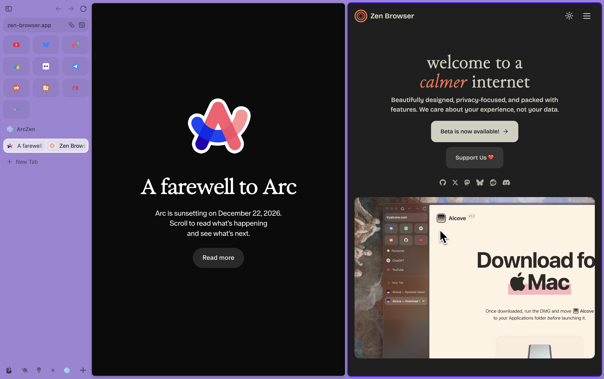

# ArcZen

<table align="center">
  <tr>
    <td align="center">
       
      <b>Arc.. to</b>
    </td>
    <td align="center">
       
      <b>Zen!</b>
    </td>
  </tr>
</table>

Due to the 22 October announcement of [Arc's sunsetting](https://resources.arc.net/hc/en-us/articles/44412972248471-Arc-Sunset-Key-Dates-and-What-to-Expect), I got scared that my favourite browser would be gone. I recalled that there were multiple options to migrate to Zen, an open source Firefox-based browser wich integrates many of Arc's features. However, none of them imported everything correctly. I had wanted to move to Zen for a while following the announcement development of Arc was winding down, and the Manifest V2 discontinuation, but this really pushed me to urgently get migration working properly.

# Acknowledgements

This project came about as two existing tools from migrating from Arc to Zen did not work perfectly. However, this tool would not be possible without them. Thanks to:
- https://github.com/Thinkscape/arc-to-zen for the Space icon and colour as well as temporary tab migration.
- https://github.com/rafcabezas/arc2zen for the Essentials migration.
  Thanks to both for tab migration and Space name migration.
- https://github.com/mozilla-firefox/firefox, specifically browser/components/migration, which allowed me to get history migration working.

As is often said, we stand on the shoulders of giants.

# AI disclosure

I used Claude Opus 5 for the coding work. Yes, I know..

In case you are wondering, here is the original prompt.

>I am trying to migrate from arc to zen. There are two open-source projects, but neither does everything.
>
>Arc-to-zen migrates the tabs and folders correctly, as well as Space icons and colours. However, it does not migrate the pinned tabs on the top.
>
>Arc2zen correctly migrates the pinned sites on the top  (though curiously only for my school profile, not my personal profile). It also correctly migrates folders and the tabs inside them. However, it adds strange coloured labels to each tab, which Arc-to-zen does not do. It also misses the Space icons and colours.
>
>Both import history properly. Neither does passwords, or automatic container set-up to configure each Space to be its own container (seperate cookies). Can you create the “ultimate” Arc to Zen migration tool?`

# About

ArcZen is a migration tool to move your browsing data from Arc to Zen. Right now, it copies:
- **Arc Spaces** mapped to containers (read on). New tabs in a Space open in their respective containers (like Arc). Space colours and icons are transferred.
    - **Folders** (including nested ones) are properly migrated.
    - **Open tabs** are copied as well, including split view tabs.
- **Profile names** are copied (using Arc's name not the Chrome profile name) from the Preferences file in Arc's User Data/Local State file (I found this myself without AI). They are linked to Spaces as containers as stated above.
- **Passwords** are extracted from Arc Secure Storage (will prompt for password, only to write them to the CSV), and exported as a CSV in the tool's root directory, which can be imported into Zen (use about:logins -> Import from a File -> arc-passwords.csv, or whatever method you are used to.)
- **Browsing history** is copied from all Spaces and put into Zen.
- **Cached favicons** are copied from Arc to Zen.

# Installation

To install, download the repository or git clone it. Then, open a terminal in the directory and run the following commands. This will install all the dependencies required for ArcZen to run. It also means your local python installation won't get clogged with dependecies, and you can just delete the repository folder once you are done.

~~~
python3 -m venv .venv
. .venv/bin/activate
pip install -e .
~~~

# Usage

To migrate from Arc to Zen, wiping everything inside Zen, use:

~~~
arczen replace
~~~

To copy Arc data from Zen, keeping existing Zen data, use:

~~~
arczen merge
~~~

Next, import your passwords via about:logins -> Import from a File -> arc-passwords.csv. Don't forget to check the option to delete the file after!

I have not personally tested merge, so there may be bugs..

Options within `replace` or `merge`:
~~~
  --arc-spaces "Spaces"
                        Copy only these spaces. Seperate each Space by a space.
  --arc-profiles "Name"
                        Copy only these profiles. Seperate each profile name by a space.
  --exclude "types"
                        Skip one or more kinds of data: tabs, temporary-tabs, favicons, history, passwords.
                        'tabs' covers pinned tabs, their folders and Essentials. 'temporary-tabs' covers Arc's
                        unpinned tabs.
  --no-containers       Do not create containers from Arc profiles
  --no-backup           Do not copy Zen's files to a backup folder before changing them
  --dry-run             Show planned changes only
  --force               Proceed even if Zen appears to be running
  --arc-path DIR        Arc data folder containing StorableSidebar.json, if auto-discovery fails.
  --zen-path DIR        Zen profile directory, or a Zen root with profiles.ini
  --verbose             Debug logging
~~~

# Known Limitations

- Zen does not have seperate history or password storage per-container as of 1.23.4b. Passwords are copied from all Arc Profiles.
- Cookie copying (so that all your apps are signed in) has not been implemented.
- If you close a tab in a split view before opening it for the first time after migration the split view may break, requiring you to unsplit the tabs then add them to a split view again.
- As vertical split views are not supported in Zen, they are imported as normal split views.
- Split views in folders are not currently imported (will be fixed soon).
- Some Space icons may be mapped incorrectly.

# Contributions

If you are a human coder or someone who can properly code with AI, please do improve on this code. It would help many of us who are trying to migrate from Arc to Zen!